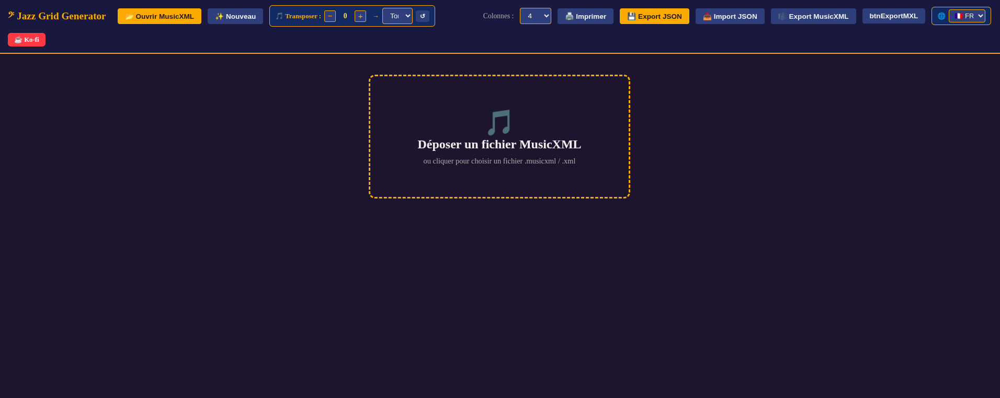

# 𝄢 Jazz Grid Generator

> A web-based jazz chord chart editor — AI assistant, music theory, bass fretboard diagrams, MusicXML import/export, optimized PDF output.


**🌐 Live demo** : https://www.virgos.fr/JazzGridGenerator/



Build jazz chord charts from scratch or by importing MusicXML files (iReal Pro®, MuseScore®…). Edit, transpose, annotate, then export to PDF — ready to use on your tablet at gigs or jam sessions.

---

## ✨ Features

- 🤖 **Conversational AI assistant (Claude only)** — bottom panel, driven by natural language: creates, edits and deletes sections, measures, chords and annotations; transposes the entire chart; preview before applying with Apply / Cancel buttons
- 📂 **MusicXML import** — drag & drop or file picker; parses chords, sections, repeat barlines, key signature, tempo (iReal Pro®, MuseScore®, Sibelius, Finale…)
- 🔎 **Find a chart** — dedicated window: DuckDuckGo search buttons (iReal Pro forum, web, free MusicXML), paste an `irealb://` / `irealbook://` link or drop a `.musicxml` / `.xml` / `.mxl` file; filterable song list for playlists, preview, import with confirmation and Ctrl+Z
- 🎹 **iReal Pro® import** — sections, repeats, voltas, coda/segno, `N.C.`, `%`, slash and alternate chords; unknown qualities kept as free symbols; untranslatable indications moved to a section annotation
- 🌐 **AI web search** — "🌐 Search the web" toggle (off by default, reset after each send; each web search is billed by Anthropic on top of the usual Claude usage): Claude searches, cites its sources and proposes a full chart through the preview; annotation "to be checked by ear"
- 🎧 **Create a chart by ear** — "🎧 Create a chart by ear" button: listen to a browser tab ("🎧 Listen to a tab": desktop Chrome/Edge, tick "Share audio" in Chrome's share window; not available on Firefox or mobile) or to a dropped audio file (mp3, wav, m4a… whatever the browser can decode), played audibly in real time. The chart fills live in the main editor, bar by bar, with the current bar highlighted ("New section" button or `N` key, editing locked, "■ Stop"). Pause: a file pauses along with the analysis; for a tab, "⏸ Pause analysis" only suspends the analysis (ads…) while the tab keeps playing, and the chart realigns to the music on resume, keeping the tempo. Settings: time signature (4/4 by default), tempo (auto, typed or tapped), 1 or up to 2 chords per bar. Chords are written as tetrads only (maj7, m7, 7, m7b5, dim7); uncertain chords get a discreet "?" (not printed, not saved in JSON); short silences become N.C., long pauses stop the bar counter. After stopping: key proposed, shift by one beat ◀ ▶, switch between 1 and 2 chords per bar, proposed sections (Apply / Ignore); confirmation if the chart was edited since stopping; Ctrl+Z restores the previous chart. Nothing is recorded or sent: analysis runs locally in the browser with a home-made engine (no library), loaded only on first use; works offline for files. Annotation "Chart detected by ear — check it by ear": the result is a first draft to check by ear
- 📦 **MXL import/export** — compressed MusicXML format
- ✏️ **Full chord editing** — 17 roots, 24 qualities, slash bass, free-form input, per-chord duration
- 🔄 **Alternate chord** — tritone substitution with automatic suggestion
- 🎼 **Music theory annotations** per chord: compatible modes, 4-note arpeggios with inversions, available tensions, avoid notes, free text notes
- 🎸 **4- and 5-string bass fretboard diagrams** — 🎸 4/5 toggle in toolbar; 17 modes in 5-string (BEADG); automatic transposition per chord root; 🔴 root · 🟡 arpeggio · 🔵 other degrees
- 🎵 **Transposition** — by semitone (±) or direct key selection, with enharmonic awareness
- 🗂️ **Section management** — labels (A–I, Intro, Verse, Chorus, Bridge, Coda…), numeric suffixes, duplicate, reorder, annotate; unique ID `#xxxx` in section header
- 🔀 **Drag & drop** — sections and measures moveable with mouse or touch
- 🎵 **Measure symbols** — `%`, `𝄎`, `N.C.`, `/`, `(w)` bass only
- 🔢 **Enhanced barlines** — normal, double, final, repeat start/end; MusicXML export/import
- 🎼 **Voltas and navigation symbols** — 1st/2nd/3rd endings, Segno, Coda, D.C., D.S., Fine
- ↩️ **Undo / Redo** — 10 levels, Ctrl+Z / Ctrl+Y shortcuts, full coverage of all actions
- 📱 **Tablet touch support** — finger drag & drop, pinch-to-zoom, enlarged touch targets
- 🖨️ **Advanced print/PDF** — light/dark theme, adjustable contrast, per-section colors, automatic font scaling on multi-chord measures; 1-page option (reduced font to fit on A4); optional hiding of navigation symbols (repeat barlines, voltas, segno/coda/fine)
- 🎭 **Concert mode** — when playback starts, the UI hides entirely (except the grid); floating bar at the bottom with measure counter and stop button; click the grid to return
- 🥁 **Metronome** — independent ♩ button in the toolbar (synced to chart tempo and time signature); also activatable from the play dialog to run alongside chord playback; adjustable volume, persisted between sessions
- 🖥️ **Fullscreen** — `⛶` button in the toolbar; hides the browser chrome (address bar, tabs); click again or press `Escape` to exit
- 💡 **Wake lock** — prevents the screen from sleeping while in fullscreen; automatically re-acquired if the tab regains focus
- 💾 **Save work in progress (JSON)** — exact restore of chords, annotations and sections
- 🎼 **MusicXML export** — compatible with MuseScore®, Sibelius, Finale, iReal Pro®
- 🎹 **MIDI export** — Standard MIDI File (Type 0): piano chord voicings (ch 0) + bass (ch 1); choose number of repetitions
- ▶ **Built-in player** — listen to the chart in your browser via SoundFont (acoustic piano + bass, CDN); follows repeat barlines, voltas, D.C./D.S. al Coda, Fine; current measure highlighted in real time; Space bar to play/stop; choose number of loops; jazz spread voicing across 2 octaves (9th/11th/13th extensions included); slash chords (e.g. `C/E`) respected in the bass
- 🗂️ **Streamlined toolbar** — 📁 File menu (New, Open, Import, Save) and ⬆ Export menu (MusicXML, MXL, MIDI, Print)
- 🌐 **4 languages** — French 🇫🇷, Spanish 🇪🇸, Italian 🇮🇹, English 🇬🇧
- ⚡ **No build step** — open `index.html` directly in a browser; the core app works offline (MXL, AI and SoundFont require a connection)

---

## 🤖 AI Assistant

The AI panel opens via the **✦ AI** tab at the bottom right of the page.

### Configuration

Click **⚙** in the panel header:

| Setting | Values |
|---------|--------|
| Claude model | `claude-opus-5-5`, `claude-sonnet-5-5`, `claude-haiku-5-5` |
| API key | Entered in the app, stored locally, never sent anywhere else |

<details>
<summary>Available tools</summary>

| Category | Tools |
|----------|-------|
| Chart | `set_chart_metadata`, `transpose_chart`, `set_columns`, `set_bass_strings` |
| Full chart | `set_full_chart` (replaces the whole chart, used with web search) |
| Sections | `add_section`, `duplicate_section`, `rename_section`, `remove_section` |
| Measures | `add_bar`, `duplicate_bar`, `remove_bar`, `set_barline` |
| Chords | `add_chord`, `edit_chord`, `remove_chord`, `set_chord_alt` |
| Annotations | `set_annotation` (with `showSvg`), `toggle_all_diagrams` |

</details>

### Workflow

1. Type a natural-language instruction
2. The AI summarizes what it will do, then calls the necessary tools
3. A preview lists the changes (*"Section B added"*, *"Dm7 → D7 bar 3"*…)
4. **Apply** → changes applied, undo snapshot pushed
5. **Cancel** → nothing changes

---

## 🚀 Getting Started

**Online** — open https://www.virgos.fr/JazzGridGenerator/ directly.

**Local** — clone the repo and open `index.html` in a browser. No build, no server required. MXL and AI features require an internet connection.

**Static host** — drop the files on any static hosting service (Netlify, Vercel, Cloudflare Pages, Apache, Nginx…).

<details>
<summary>Project architecture</summary>

```
index.html
css/
├── app.css          ← UI styles, toolbar, 4/5-string toggle, AI panel
├── modals.css       ← modal styles
└── print.css        ← print styles, multi-chord font scaling
js/
├── i18n.js          ← translation dictionary (FR/ES/IT/EN)
├── diagrams.js      ← 4 and 5-string SVGs, diagram transposition
├── theory.js        ← music theory engine (scales, arpeggios, tensions)
├── state.js         ← global state shared across modules
├── render.js        ← DOM rendering
├── modals.js        ← chord and annotation dialogs
├── actions.js       ← chart mutations, auto-annotation on import
├── print.js         ← print theming and per-section color system
├── touch.js         ← touch support (Touch Events, pinch-to-zoom)
├── ai.js            ← Claude AI assistant (tools, draft, chat, web search, settings)
├── ireal.js         ← iReal Pro link decoder (irealb://, irealbook://)
├── gridsearch.js    ← "Find a chart" window
├── listen.js        ← "Build a chart by ear" (capture, bars, live preview)
├── listen-dsp.js    ← audio analysis engine (loaded on demand)
└── init.js          ← initialization, session restore
tests/                ← Node tests (ai, gridsearch, ireal, listen-dsp, listen, uncertain)
doc/
└── doc.html         ← full documentation
```

</details>

---

## 🧪 Tests

Node is only needed to run the tests, not to use the app:

```bash
node --test tests/*.test.js
```

---

## 🎸 Bass Diagrams

<details>
<summary>Modes with 5-string diagrams (17/17)</summary>

| Mode | Key in `diagrams.js` | Mode | Key in `diagrams.js` |
|------|---------------------|------|---------------------|
| Ionian | `Ionien_5` | Lydian b7 | `LydienB7_5` |
| Dorian | `Dorien_5` | Altered | `Altere_5` |
| Phrygian | `Phrygien_5` | Melodic minor | `MelodieMineure_5` |
| Lydian | `Lydien_5` | Harmonic minor | `MinHarmonique_5` |
| Mixolydian | `Mixolydien_5` | Mixolydian b9b13 | `MixolydienB9B13_5` |
| Aeolian | `Aeolien_5` | Lydian augmented | `LydienAugmente_5` |
| Locrian | `Locrien_5` | Locrian #2 | `LocrienDiese2_5` |
| Half-whole dim. | `DimDemiTon_5` | Whole-half dim. | `DimTonDemi_5` |
| Whole tone | `TonsEntiers_5` | | |

</details>

---

## ↩️ Undo / Redo

<details>
<summary>Full coverage</summary>

| Action | Covered |
|--------|---------|
| Add / delete / duplicate chord | ✅ |
| Annotation edit | ✅ |
| Add / delete / duplicate measure | ✅ |
| Add / delete section | ✅ |
| Drag & drop section or measure | ✅ |
| Barline change | ✅ |
| Volta (1st / 2nd / 3rd ending) | ✅ |
| Navigation symbol | ✅ |
| Alternate chord | ✅ |
| Apply AI draft | ✅ |

Depth: **10 levels**.

</details>

---

## 🎼 Music Theory

<details>
<summary>Suggested modes per chord quality</summary>

| Quality | Suggested modes |
|---------|----------------|
| `maj7` | Ionian, Lydian, Lydian augmented |
| `7` | Mixolydian, Lydian b7, Altered, Mixolydian b9b13 |
| `m7` | Dorian, Aeolian, Phrygian, Harmonic minor |
| `m7b5` | Locrian, Locrian #2 |
| `dim7` | Whole-half diminished, Half-whole diminished |
| `mM7` | Melodic minor, Lydian augmented, Harmonic minor |
| `aug` | Whole tone |

</details>

---

## 📱 Tablet Support

<details>
<summary>Technical details</summary>

- **Touch drag & drop** — Touch Events on sections and measures
- **Pinch-to-zoom** — pinch the chart grid to zoom (0.5× to 2×)
- **Enlarged targets** — `@media (pointer: coarse)` increases barline, nav, and chord button sizes
- **MutationObserver** — elements added after a render are automatically patched for touch

</details>

---

## 🖨️ Print / PDF

<details>
<summary>Fine-tuning options</summary>

**Multi-chord measures**

| Number of chords | Chord symbol | Theory area | Max height |
|-----------------|-------------|-------------|------------|
| 2 chords | 0.72rem | 0.52rem | 2.6em |
| 3+ chords | 0.62rem | 0.44rem | 2.2em |

**Popup menus** — barline, volta and navigation menus automatically reposition to stay within the screen.

</details>

---

## 📋 Changelog

### v5.1 (November 2026)
- ✅ Find a chart — "🔎 Find a chart" window: DuckDuckGo search (iReal Pro forum, web, free MusicXML), paste an iReal Pro link or drop a MusicXML file, preview then import
- ✅ iReal Pro® import — decodes `irealb://` and `irealbook://` links: sections, repeats, voltas, coda/segno, `N.C.`, `%`, slash chords
- ✅ AI assistant on Claude only — OpenAI removed; Opus 5.5 (default), Sonnet 5.5, Haiku 5.5 models
- ✅ AI web search — "🌐 Search the web" toggle (off by default, billed by Anthropic on top of regular Claude usage)
- ✅ Create a chart by ear — "🎧 Create a chart by ear": browser tab (desktop Chrome/Edge) or audio file; chart filled live, seventh chords only, uncertain chords marked "?", analysis pause for tabs; on stop: key, one-beat shift, proposed sections; local analysis, nothing is recorded or sent
- ✅ Node tests — `node --test tests/*.test.js`

### v5.0 (July 2026)
- ✅ Fullscreen — `⛶` button in the toolbar; hides browser chrome (address bar, tabs); click again or `Escape` to exit; synced with the browser's native fullscreen button via `fullscreenchange`
- ✅ Wake lock — prevents screen sleep while in fullscreen; released on exit; re-acquired on tab focus (`visibilitychange`); silent fallback on unsupported browsers (Firefox)

### v4.9 (June 2026)
- ✅ Concert mode — on playback start, UI hides (except grid); floating bar with measure counter and stop button; click grid to return
- ✅ Metronome — ♩ toolbar button (independent) + option in play dialog (synced to chords); follows chart tempo and time signature; adjustable volume, persisted
- ✅ 1-page print — option to scale down font and fit the entire grid on a single A4 page
- ✅ Nav symbols in print — hidden by default, optional display; print color forced to black for optimal visibility

### v4.8 (June 2026)
- ✅ Jazz voicings in the player — spread across 2 octaves (each note strictly above the previous), all extensions (9th, 11th, 13th) included, slash chords (`C/E`, `Dm7/F`…) respected in the bass

### v4.7 (June 2026)
- ✅ MIDI export — Standard MIDI File (Type 0): piano chord voicings + bass, repetitions selector
- ✅ Built-in player — Web Audio + SoundFont (acoustic piano + bass from CDN); full navigation (repeats, voltas, D.C./D.S. al Coda, Fine); current measure highlighted; Space bar play/stop
- ✅ Streamlined toolbar — 📁 File and ⬆ Export dropdown menus; 7 distinct zones instead of 17 scattered buttons

### v4.6 (May 2026)
- ✅ MusicXML import (`.musicxml`, `.xml`, `.mxl`) in the Songbook, alongside existing `.json` JGG import
- ✅ Fix Songbook auto-scroll — rAF loop no longer stopped immediately when iframe had no overflow content yet

### v4.5 (May 2026)
- ✅ Jazz Songbook — companion app (`songbook/`): song library, setlists, audio player, adjustable auto-scroll
- ✅ JGG iframe integration in view mode (`?mode=view`) from the Songbook
- ✅ BLE-MIDI — HX Stomp connection, Program Change + CC via Web Bluetooth
- ✅ IndexedDB — local persistence for songs/setlists/audioblobs
- ✅ JGG view mode: hides editing UI, supports previous/next setlist navigation

### v4.4 (May 2026)
- ✅ Browser warns before closing the tab if unsaved changes are present (`_isDirty` flag, `beforeunload` listener)

### v4.3 (May 2026)
- ✅ Unique section IDs (`#xxxx`), persisted in JSON, hidden when printing; automatic migration for legacy files
- ✅ New AI tool `toggle_all_diagrams`
- ✅ `set_annotation` exposes `showSvg` to control diagram visibility per chord
- ✅ Fix: MXL export/import restored; metadata fields readable when printing

### v4.2 (May 2026)
- ✅ Markdown rendering in AI responses — paragraphs, lists, **bold**, *italic*, `code`

### v4.0 (May 2026)
- ✅ Conversational AI assistant — Claude and OpenAI®
- ✅ 15 AI tools: sections, measures, chords, annotations, metadata, transposition
- ✅ Draft-preview-apply workflow with change list and integrated undo
- ✅ AI panel as full-width bottom bar, slide-up animation

→ [Full changelog](CHANGELOG.md)

---

## 📋 Roadmap

- [ ] Custom color picker per section
- [x] ~~Import iReal Pro® `.irealbook`~~ (`irealb://` / `irealbook://` links via "Find a chart", v5.1)
- [ ] Diagrams: choose between the current display (SVG mode diagram) and tetrads as 4- or 5-string bass tablature
- [x] ~~Percussion / metronome track in the player~~ (metronome shipped in v4.9)

---

## 📄 License

Apache 2.0 — *𝄢 Made with love for musicians, by a bass player.*
